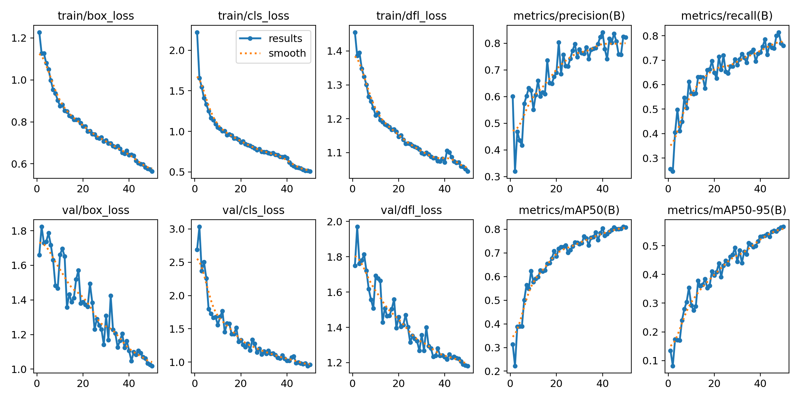
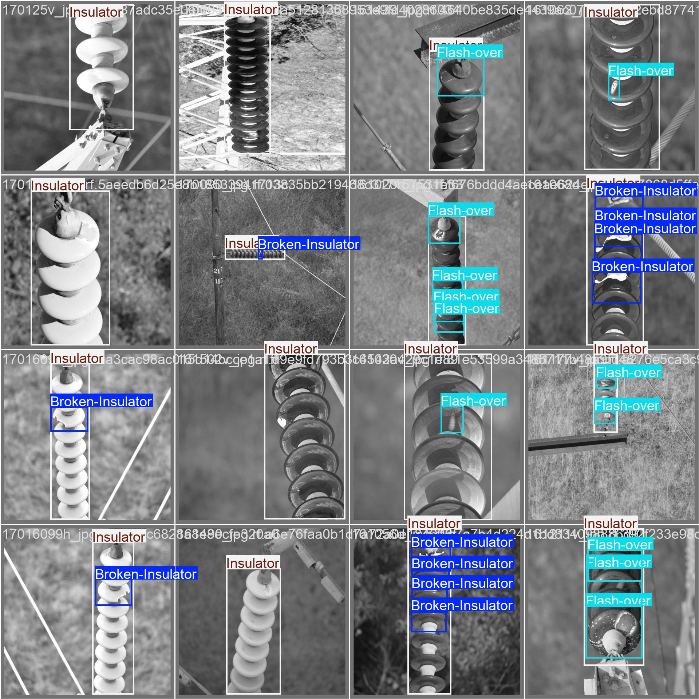
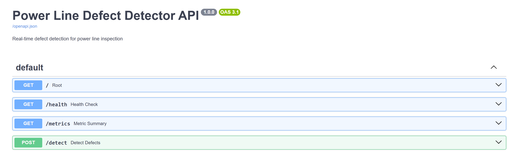

# Power Line Defect Detector

## 🎯 Project Overview

This project builds a computer vision system that detects damaged insulators and other hardware defects in aerial power line inspection images. It includes a preprocessing pipeline, YOLOv8 training and evaluation scripts, and a FastAPI inference server for running detections and generating reports.

Built for power utility inspection workflows to detect:
- **Broken Insulators** - Physical damage to insulation hardware
- **Flash-over Defects** - Electrical discharge damage
- **Normal Insulators** - Baseline for comparison

---
## Results

YOLOv8n trained for 50 epochs on 1,000+ labelled aerial images. Final-epoch validation metrics:

| Metric    | Value  |
| --------- | ------ |
| mAP50     | ~0.81  |
| mAP50-95  | ~0.57  |
| Precision | ~0.82  |
| Recall    | ~0.76  |



On CPU, a single request takes about 226 ms on average (~4 requests/s; see [Load Testing](#load-testing-concurrent-requests)).

## **Sample Predictions**


## 🚀 Inference API

### Running the Server

Start the FastAPI server:
```bash
python src/api.py
```

Or with uvicorn:
```bash
uvicorn src.api:app --host 0.0.0.0 --port 8000
```

Server will be available at:
- **API**: `http://localhost:8000`
- **Interactive Docs**: `http://localhost:8000/docs`

### API Documentation



---

## 🔧 API Endpoints

### `GET /`
Health check endpoint

**Response:**
```json
{
  "status": "online",
  "model": "YOLOv8n Power Line Defect Detector",
  "version": "1.0.0"
}
```

### `GET /health`
Detailed health check with model info

**Response:**
```json
{
  "status": "healthy",
  "model_loaded": true,
  "classes": ["Broken-Insulator", "Flash-over", "Insulator"]
}
```

### `POST /detect`
Detect defects in uploaded image

**Request:**
- Method: `POST`
- Content-Type: `multipart/form-data`
- Body: `file` (image file)

**Example Response:**


```json
{
  "success": true,
  "detections": [
    {
      "class": "Insulator",
      "confidence": 0.8345798850059509,
      "bbox": {
        "x1": 0.457763671875,
        "y1": 1.0330810546875,
        "x2": 639.0557861328125,
        "y2": 624.591796875
      }
    }
  ],
  "num_defects": 1,
  "inference_time_ms": 138.61,
  "fps": 7.21,
  "annotated_image_base64": "..."
}
```
### `GET /metrics`
Returns a plain-text performance summary for each endpoint (avg / p95 latency + throughput). Useful for validating performance under repeated calls and comparing before vs after optimizations.

**Response (example):**
```text
=== Performance Summary ===
/detect
  count = 25  success = 25  errors = 0  err_rate = 0.0%
  total: avg = 182.4ms  p95 = 241.7ms
  model: avg = 128.6ms  p95 = 170.2ms
  throughput = 4.91 req/s
  items/sec = 4.91

---

## 💻 Usage Examples

### Using curl
```bash
curl -X POST "http://localhost:8000/detect" \
  -F "file=@powerline_image.jpg" \
  > response.json
```

### Using Python
```python
import requests

with open('powerline_image.jpg', 'rb') as f:
    response = requests.post(
        'http://localhost:8000/detect',
        files={'file': f}
    )
    
result = response.json()
print(f"Found {result['num_defects']} defects")
print(f"Inference: {result['inference_time_ms']:.2f}ms")
print(f"FPS: {result['fps']:.2f}")
```

### Using the Interactive Docs
1. Navigate to `http://localhost:8000/docs`
2. Click on **POST /detect**
3. Click **"Try it out"**
4. Upload an image
5. Click **"Execute"**
6. View results in the response body

---


## Load Testing (Concurrent Requests)

`POST /detect` was stress-tested using `scripts/load_test.py` to quantify latency under concurrency and observe throughput saturation under CPU-bound inference.

### Baseline Load Test (`scripts/load_test.py`)

```text
Concurrency = 1, Requests = 50
ok = 50 err = 0
avg = 241.7ms p95 = 332.8ms
throughput = 3.79 req/s

Concurrency = 5, Requests = 50
ok = 50 err = 0
avg = 1683.0ms p95 = 3004.4ms
throughput = 2.77 req/s

Concurrency = 10, Requests = 50
ok = 50 err = 0
avg = 2532.9ms p95 = 4358.3ms
throughput = 3.28 req/s

Concurrency = 25, Requests = 50
ok = 50 err = 0
avg = 6218.3ms p95 = 8225.0ms
throughput = 3.13 req/s
```

### Run the Load Test

Start the API:
```bash
python src/api.py
```
In a second terminal:
```bash
python scripts/load_test.py
```

### Load Test Results (`scripts/load_test.py`)

```text
  Concurrency = 1, Requests = 50
  ok = 50 err = 0
  avg = 226.4ms p95 = 302.1ms
  throughput = 3.96 req/s

  Concurrency = 5, Requests = 50
  ok = 50 err = 0
  avg = 808.8ms p95 = 1122.5ms
  throughput = 5.01 req/s

  Concurrency = 10, Requests = 50
  ok = 50 err = 0
  avg = 1661.8ms p95 = 2103.7ms
  throughput = 4.97 req/s

  Concurrency=25, Requests=50
  ok = 50 err = 0
  avg = 3991.4ms p95 = 5897.4ms
  throughput = 4.50 req/s
```
Throughput saturates around ~5 req/s while p95 latency climbs rapidly as concurrency increases.
The service is CPU bound under load, so additional concurrency mainly increases queueing delay rather than scaling throughput.

### Attempted Control: Inference Semaphore (Request Queue)

Added an `asyncio.Semaphore` around inference to cap in-flight executions (tested at 2 and 4). Throughput and tail latency did not improve under high concurrency; queueing shifted from CPU contention to server-side waiting.

### Optimization: Disable Annotated Image Generation for Throughput Mode

Added an `annotate` toggle to skip `results.plot()` + JPEG encode + base64 payload under load:

- `POST /detect?annotate=true` returns annotated base64
- `POST /detect?annotate=false` returns detections only

### Optimized Results (`annotate=false`, `scripts/load_test.py`)

```text
Concurrency = 1, Requests = 50
ok = 50 err = 0
avg = 235.7ms p95 = 307.4ms
throughput = 3.87 req/s

Concurrency = 5, Requests = 50
ok = 50 err = 0
avg = 1112.0ms p95 = 1275.8ms
throughput = 4.03 req/s

Concurrency = 10, Requests = 50
ok = 50 err = 0
avg = 2131.8ms p95 = 2527.8ms
throughput = 4.08 req/s

Concurrency = 25, Requests = 50
ok = 50 err = 0
avg = 4215.7ms p95 = 5678.8ms
throughput = 4.11 req/s
```
Disabling annotation did not improve performance: throughput was slightly lower at every concurrency level and p95 latency was higher except at concurrency 25. Annotated-image rendering and base64 encoding are therefore not the bottleneck; model inference on the CPU is. The toggle is still useful for smaller response payloads, but scaling throughput would need batching, a smaller input size, or GPU/ONNX Runtime inference.

## 🎓 Technical Details

### Model Architecture
- **Base Model**: YOLOv8n (nano variant)
- **Parameters**: 3.2M
- **Input Size**: 640×640 pixels
- **Classes**: 3 (Broken-Insulator, Flash-over, Insulator)
- **Framework**: PyTorch via Ultralytics

### Training Configuration
```python
epochs=50
batch_size=16
optimizer='SGD'
learning_rate=0.01
augmentation=['mosaic', 'hsv', 'rotation', 'scale', 'flip']
```

## Prerequisites

- Python 3.10+ recommended
- Windows, macOS, or Linux
- (Optional) NVIDIA GPU with CUDA for faster training

## Setup

### 1) Create and activate a virtual environment

Windows PowerShell:
```powershell
python -m venv venv
.\venv\Scripts\activate
```

### 2) Install Dependencies
```
pip install -r requirements.txt
```

---

### 3) Dataset

This project expects a YOLOv8-style dataset layout under dataset/:\
```
dataset/
  train/
    images/
    labels/
  valid/
    images/
    labels/
  test/
    images/
    labels/
  data.yaml
```

### 4) Project Process 

1. **Prepare the dataset**
   - Collect and label images in YOLO format and split into train/val/test.
2. **Preprocess images**
   - Improve consistency across lighting and camera angles (e.g., contrast enhancement and basic augmentation).
3. **Train the detector**
   - Train a YOLOv8 model (commonly YOLOv8n for CPU-friendly inference) and save the best weights.
4. **Evaluate**
   - Validate performance using standard detection metrics (e.g., mAP).
5. **Deploy**
   - Load the trained weights in a FastAPI service for inference and reporting.

## Inference API (What It Does)

A FastAPI server runs the trained model and exposes endpoints to:
- **Detect defects on a single image** and return structured detections (class, confidence, bounding boxes), optionally with an annotated image.
- **Process multiple images** in one request (batch inference).
- **Generate a PDF inspection report** summarizing detections and including annotated images.

## Running the API (Typical)

Start the server:
```bash
python src/api.py
```

Or with uvicorn (if your app is defined as `app` in `src/api.py`):
```bash
uvicorn src.api:app --host 0.0.0.0 --port 8000
```

Then open:
- `http://localhost:8000/docs` for interactive API docs.

## 📄 License

MIT License - See LICENSE file for details

---